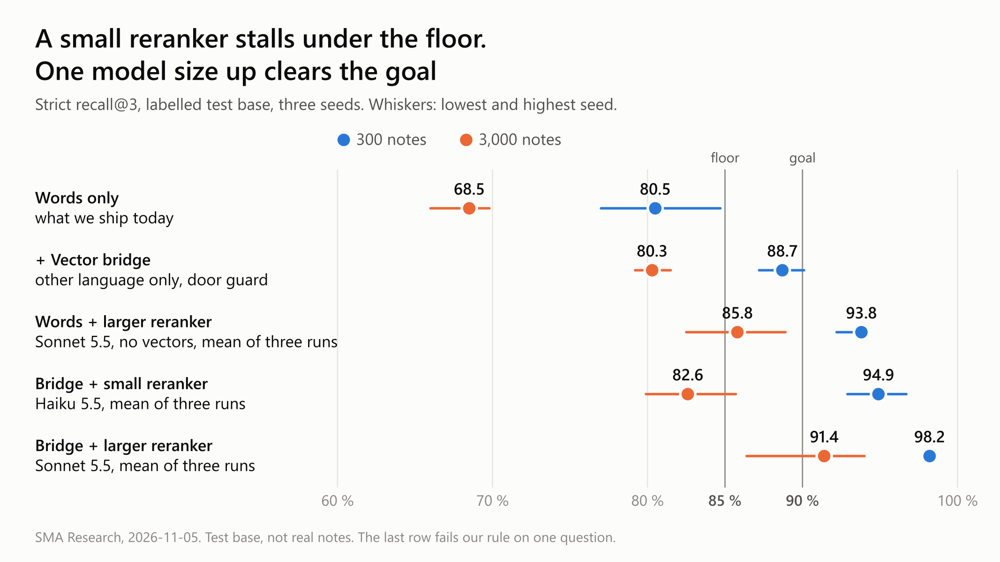
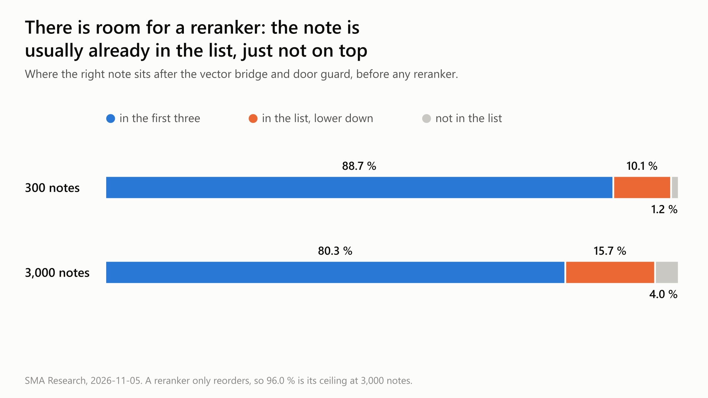
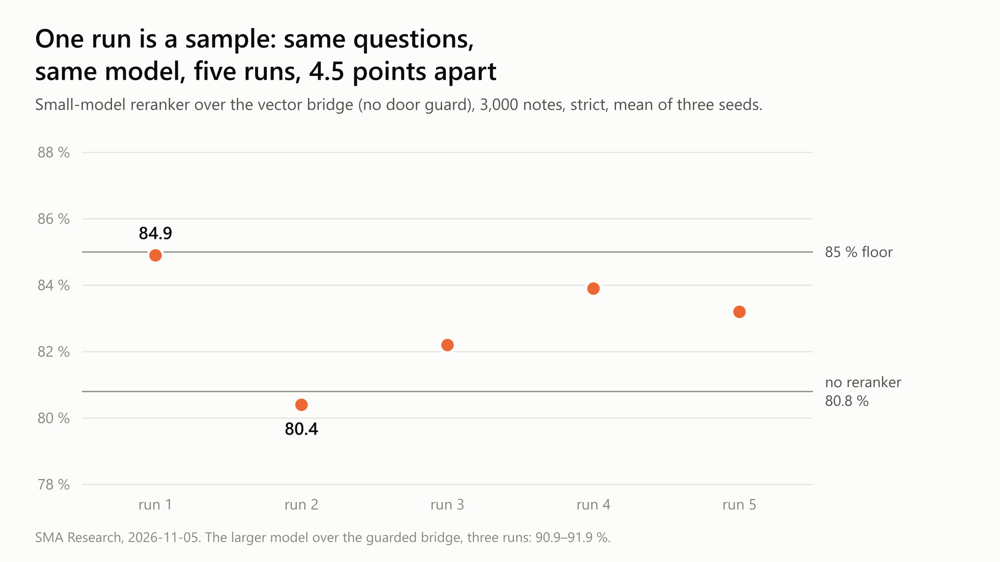

# How far can an agent's memory search go? Vectors, a reranker and the road to 85–90 %

**English** · [Русский](README.ru.md)

*A short note from building SMA (Self-Mending Automation), a personal orchestrator for AI agents. The code is closed. The numbers, the failures and what we would do again are here. Everything was measured on a labelled test base, not on production notes, up to 5 November. Since 8 November the vector bridge with its door guard is in our product, switched off by default; the reranker is not.*

> **In short.** Word search puts the right note in the first three results 80.5 % of the time at 300 notes and 68.5 % at 3,000. A vector search limited to the other language adds 8 and 12 points. A small LLM reranker takes 300 notes to about 95 % and stalls at about 83 % at 3,000. One model size up, with the same prompt and nearly the same wait, the reranker reaches 98 % and 91 %. That clears our 90 % goal on a test base. It has not met real notes or our closed questions yet, and by our own rule it still fails on one question.

---

## The problem

An agent's memory fails quietly. The rule exists, the agent does not find it, and a person repeats himself. So we measure one thing: **is the right note in the first three results?**

We hold ourselves to 85 % as the floor and 90 % as the goal, at 3,000 notes. The kind of note matters too: at 3,000 notes our search scored 81 % on synthetic notes and 42 % on mixed ones.

---

## The results

Strict recall@3, mean of three seeds. The lowest and highest seed are in brackets. Runs of a reranker are averaged, and the brackets cover every run.

| Stack | 300 notes | 3,000 notes | Passes our rule? |
|---|---|---|---|
| Words only | 80.5 % (77.0–84.7) | 68.5 % (66.0–69.8) | baseline |
| Words + vector bridge with a door guard | 88.7 % (87.2–90.1) | 80.3 % (79.2–81.5) | **yes** |
| Words + small reranker (Claude Haiku 5.5), one run | 92.2 % (92.2–92.2) | 77.0 % (72.9–83.1) | no |
| Words + larger reranker (Claude Sonnet 5.5), three runs | 93.8 % (92.2–94.1) | 85.8 % (82.5–88.9) | no, by one class in one run of three |
| Bridge and guard + small reranker (Claude Haiku 5.5), three runs | 94.9 % (92.9–96.7) | 82.6 % (79.9–85.7) | no |
| Bridge and guard + larger reranker, three runs | 98.2 % (97.9–98.6) | 91.4 % (86.4–94.0) | **no, by one question** |

**Our rule.** A stack passes only if recall rises significantly at both sizes, no class of question falls, no forbidden note appears, and questions with no answer stay unanswered.

The small reranker fails it: at 3,000 notes its gain is within noise. The larger one rises on every seed at both sizes, shows no forbidden note, and brings the critical rule every time. A reranker only reorders, so it cannot open a question the guard left shut.

It fails on one point. One class falls at 300 notes, from 21 of 21 to 18 of 21, and all of that is one question lost on each seed. We read it: the question asks what each worker attempt proves, and the labelled note's text, as our test base hands it over, is cut off mid-sentence and does not say. The reranker chose notes about receipts and about attempts. That looks like a fault in our fixture, but we have not changed the label or the rule to make the row pass.

---

## If you want 85–90 %, do this

**The short version.** If note text may leave your machine, a capable reranker is the largest single step: 85.8 % at 3,000 notes with no vectors at all, and 91.4 % with vectors under it. If it may not, the bridge and guard stopped at 80 % at 3,000 notes for us, and the local reranker we tried did not help.

**1. Build the ruler first.** Labelled questions, a person signs the labels, part of them stays closed. Test at more than one corpus size, on notes as close to real ones as you can get. Compare stacks on the same questions, across several seeds.

**2. Keep word search.** It is cheap, repeatable and explainable. Everything below sits on top of it.

**3. Add vectors as a bridge, not as one more layer.** Let them search only notes in the other language than the question. A plain vector layer had the best recall of the vector stacks (95.0 % and 82.5 %), but it let older versions and other repositories' notes in. It also stopped staying silent: questions with no answer held 0 of 10, against 6 of 10 before it. Of the models we tried, bge-m3 beat the smaller ones, most of all at 3,000 notes (80.8 % against 74.6 % and 71.9 % as a bridge). Cost: 560 MB on disk, 1.2–1.3 GB in memory, about 60 ms a question on two ARM cores.

**4. Put a guard on the door.** Vectors may not open a question that the word layers left shut. That keeps silence where it was, at any corpus size. It cost 5 questions at 300 notes and 2 at 3,000. A similarity threshold does not do this job: the nearest note to an unanswerable question is about as close as the right note to an answerable one, and the threshold has to be refitted for every size.

**5. Compute each note's vector once and keep it.** With 8-bit models a text's vector depends on what else is in its batch: the first three results moved on 22–32 of 46 questions. Hold the model in a resident process, embed the question alone, and let a hook fall back to words when that process is silent.

**6. Pin what must arrive.** A reranker can push out the one rule that matters: our local one lost a critical rule in 6 of 6 cases. Decide this before you add one.

**7. Rerank the top 20 with a capable LLM, where a few seconds are acceptable.** A reranker only reorders, so it has room to work:

Try one model size up before you build anything around a small one. Over the same list and with the same prompt, Claude Haiku 5.5 added 2 points at 3,000 notes and Claude Sonnet 5.5 added 11. Over words alone the gap is as wide: 77.0 % against 85.8 %, and the small model also dropped the class of questions about the right repository to 12 of 21. The larger model also changed its mind less: its first three differed between two runs on 11 % of questions, against 31 %. The wait barely differs through the command-line tool, about 3.3 and 3.6 seconds a question (4.6 and 7.1 at the 95th percentile). Both used about 1,400 input tokens and fewer than 100 output tokens a question. At list price the larger one is about $0.004 a question, about 25 times the small one.

Show notes by number and text, never by file name. Give it no tools. Fall back to the previous order on a timeout. A few seconds rules out a hook on every tool call. Accept that note text leaves your machine, or do not use this step.

**8. Measure anything you stack on top of the reranker.** We tried votes over several runs and moving near-copies out of the first three. With the small model they touched 85.1 %, at the best of four thresholds and with seeds from 76.6 % to 90.6 %. With the larger model they gave nothing useful: 92.1 % for a vote at three times the calls, 90.8–92.1 % with copies moved, and worse at 300 notes. Merging duplicates when notes are written may still be worth doing. We have not measured that.

**9. Judge on questions nobody tuned against.** The stack under the reranker was tuned on the questions it was measured on. Only a closed set can say whether it holds.

---

## What did not work

| We tried | What happened |
|---|---|
| A plain vector layer | Good recall, but classes fell and silence broke |
| A similarity floor | Works only at the size it was fitted for, and costs more than the door guard |
| A local cross-encoder (bge-reranker-v2-m3) | Noise against the order it reorders, and it lost a critical rule in 6 of 6 cases |
| Voting to raise recall | Narrows the spread but barely lifts the mean |
| Moving copies down without a reranker | Worse at 300 notes, noise at 3,000 |
| Telling the reranker which repository is asking | Dropped before running: 18 of 21 notes that took those places were from the right repository |

---

## What surprised us

**The size of the model decided it.** We spent two days on votes, thresholds and copies to get a small model past 85 %. The first draft of this note said we had not reached 90 %. Then we added one control run, only to check whether the limit was the model, and it cleared 90 % at once.

**One run is a sample.** Same small model, same questions, five runs: at 3,000 notes the result moved between 80.4 % and 84.9 %. Had we stopped at the first run, we would have reported 84.9 %, the luckiest of the five. The larger model moved less, 90.9 % to 91.9 % over three runs, and we ran it three times for the same reason.

**Our parser threw away a quarter of the answers.** The model sometimes answered `["[1]","[17]",…]` instead of `[1,17,…]`, and 83 of the first 316 answers stayed unranked and silently kept the old order. Nothing failed. We found it only because the failure rate looked odd.

**An old claim of ours needs correcting.** On 19 October we wrote that at this corpus size plain retrieval you can explain beat clever retrieval you cannot. On this measurement it does not: vectors and a reranker gain about 18 points at 300 notes and 23 at 3,000. What we still believe is the other half: nothing gets in unless it passes a rule that can refuse it.

---

## What this does not show

- **It is a test base.** It has 151 labelled questions, and each seed samples 79 of them. The notes are filled out with filler and deliberate near-copies, so real memory may behave better or worse.
- **Its notes are short.** The reranker reads little more than one sentence a note. Long real notes will cost more tokens and may rank differently.
- **Strict counts the same fact in other words as a miss.** That is on purpose, and it makes some losses look worse than they are.
- **The closed questions are unopened.** The real test is all 240 signed questions, with the 77 closed ones reported separately. We tuned nothing for the larger model, but these are the same questions that shaped the stack beneath it.
- **The reranker has not met a planted instruction.** Those notes are filtered before it, so we have not tested one reaching it.
- **Only the bridge is in the product, switched off by default.** The reranker and everything stacked on it are measurements.

---

## Questions for you

1. What is your recall at ten times your current number of notes?
2. Who signed your labels, and which questions has nobody tuned against?
3. What does your memory answer when the right answer is "nothing"?
4. Have you asked your reranker the same question twice?
5. How many of your model's answers does your parser drop without telling you?
6. What happens if you try one model size up before adding anything else?

---

*Written by Matvey. Text: [CC BY 4.0](../LICENSE). This repository contains ideas only, no code.*
