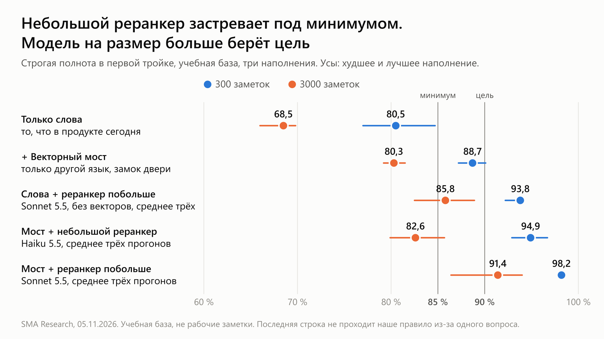
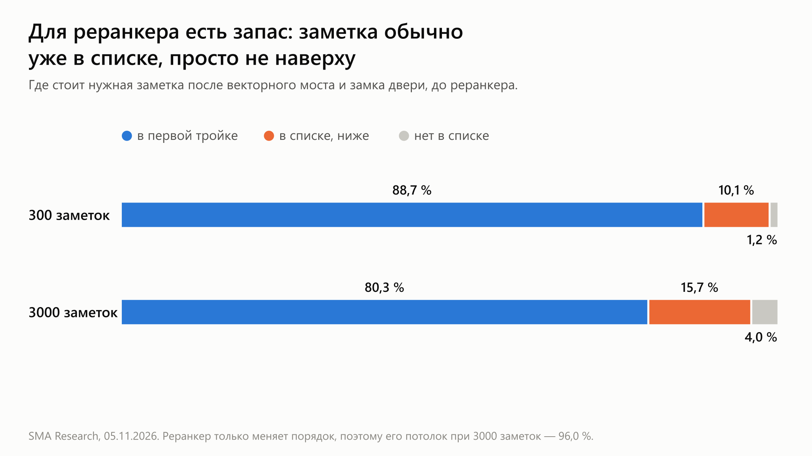
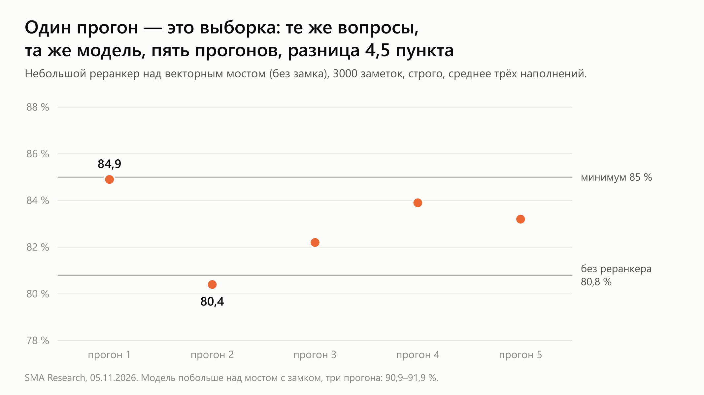

# Как далеко может зайти поиск в памяти агента? Векторы, реранкер и дорога к 85–90 %

[English](README.md) · **Русский**

*Короткая заметка о том, как мы строим SMA (Self-Mending Automation), личный оркестратор для ИИ-агентов. Код закрыт. Здесь числа, провалы и то, что мы сделали бы снова. Всё измерено на размеченной учебной базе, а не на рабочих заметках, по 5 ноября. С 8 ноября векторный мост с замком двери есть в нашем продукте и по умолчанию выключен; реранкера в нём нет.*

> **Коротко.** Поиск по словам ставит нужную заметку в первую тройку в 80,5 % случаев при 300 заметках и в 68,5 % при 3000. Векторный поиск только по другому языку добавляет 8 и 12 пунктов. Небольшой LLM-реранкер доводит 300 заметок примерно до 95 %, а при 3000 застревает около 83 %. Модель на размер больше, с тем же промптом и почти тем же ожиданием, даёт 98 % и 91 %. Это выше нашей цели в 90 % на учебной базе. С рабочими заметками и закрытыми вопросами она ещё не встречалась, а наше собственное правило пока не проходит из-за одного вопроса.

---

## Задача

Память агента отказывает молча. Правило есть, агент его не находит, и человек повторяет всё заново. Поэтому мы меряем одно: **есть ли нужная заметка в первых трёх результатах?**

Наша планка при 3000 заметок: 85 % минимум, цель 90 %. Важно и то, какие это заметки: при 3000 наш поиск дал 81 % на синтетических заметках и 42 % на смешанных.

---

## Результаты

Строгая полнота в первой тройке, среднее по трём наполнениям. В скобках худшее и лучшее наполнение. Прогоны реранкера усреднены, скобки охватывают все прогоны.

| Сборка | 300 заметок | 3000 заметок | Проходит наше правило? |
|---|---|---|---|
| Только слова | 80,5 % (77,0–84,7) | 68,5 % (66,0–69,8) | база |
| Слова + векторный мост и замок двери | 88,7 % (87,2–90,1) | 80,3 % (79,2–81,5) | **да** |
| Слова + небольшой реранкер (Claude Haiku 5.5), один прогон | 92,2 % (92,2–92,2) | 77,0 % (72,9–83,1) | нет |
| Слова + реранкер побольше (Claude Sonnet 5.5), три прогона | 93,8 % (92,2–94,1) | 85,8 % (82,5–88,9) | нет, из-за одного класса в одном прогоне из трёх |
| Мост и замок + небольшой реранкер (Claude Haiku 5.5), три прогона | 94,9 % (92,9–96,7) | 82,6 % (79,9–85,7) | нет |
| Мост и замок + реранкер побольше, три прогона | 98,2 % (97,9–98,6) | 91,4 % (86,4–94,0) | **нет, из-за одного вопроса** |

**Наше правило.** Сборка проходит, только если полнота значимо растёт при обоих размерах, ни один класс вопросов не падает, запрещённых заметок нет, а вопросы без ответа остаются без ответа.

Небольшой реранкер его не проходит: при 3000 его прибавка в пределах шума. Реранкер побольше растёт на каждом наполнении при обоих размерах, запрещённых заметок не показывает и критичное правило приносит каждый раз. Реранкер только меняет порядок, поэтому открыть вопрос, который замок оставил закрытым, он не может.

Отказ один. При 300 заметках падает один класс, с 21 из 21 до 18 из 21, и всё это один вопрос, потерянный на каждом наполнении. Мы его прочитали: вопрос спрашивает, что доказывает каждая попытка работника, а текст нужной заметки в нашей учебной базе обрезан на полуслове и этого не говорит. Реранкер выбрал заметки про квитанции и про попытки. Похоже, это изъян нашей заготовки, но ни разметку, ни правило мы ради этой строки не меняли.

---

## Если хотите 85–90 %, делайте так

**Короче всего.** Если текст заметок может уходить с вашей машины, толковый реранкер — самый большой одиночный шаг: 85,8 % при 3000 заметок вообще без векторов и 91,4 % с векторами под ним. Если не может, то мост и замок остановились у нас на 80 % при 3000 заметок, а опробованный локальный реранкер не помог.

**1. Сначала постройте линейку.** Размеченные вопросы, разметку подписывает человек, часть вопросов остаётся закрытой. Проверяйте при нескольких размерах памяти, на заметках как можно ближе к настоящим. Сравнивайте сборки на одних и тех же вопросах, на нескольких наполнениях.

**2. Оставьте поиск по словам.** Он дешёвый, повторяемый и понятный. Всё остальное стоит поверх него.

**3. Добавьте векторы как мост, а не как ещё один слой.** Пусть они ищут только заметки на другом языке, чем вопрос. У обычного векторного слоя лучшая полнота среди векторных сборок (95,0 % и 82,5 %), но он пропустил старые версии и заметки чужих репозиториев. И он перестал молчать: вопросы без ответа держались на 0 из 10 вместо прежних 6 из 10. Из проверенных моделей bge-m3 оказалась сильнее меньших, больше всего при 3000 заметок (80,8 % против 74,6 % и 71,9 % в форме моста). Цена: 560 МБ на диске, 1,2–1,3 ГБ в памяти, около 60 мс на вопрос на двух ядрах ARM.

**4. Поставьте замок на дверь.** Векторам нельзя открывать вопрос, который слой слов оставил закрытым. Так молчание остаётся на прежнем месте при любом размере памяти. Цена: 5 вопросов при 300 заметках и 2 при 3000. Порог схожести эту работу не делает: ближайшая заметка к вопросу без ответа почти так же близка, как нужная заметка к обычному вопросу, а порог приходится подбирать под каждый размер.

**5. Считайте вектор каждой заметки один раз и храните его.** У 8-битных моделей вектор текста зависит от соседей в пачке: первая тройка менялась на 22–32 вопросах из 46. Держите модель в постоянном процессе, вопрос считайте отдельно, а если процесс молчит, пусть хук возвращается к словам.

**6. Закрепите то, что обязано дойти.** Реранкер может вытеснить единственное правило, которое здесь важно: наш локальный потерял критичное правило в 6 случаях из 6. Решите это до того, как его добавлять.

**7. Переставляйте верхние 20 заметок толковой LLM-моделью там, где можно подождать несколько секунд.** Реранкер только меняет порядок, и работы для него хватает:

Попробуйте модель на размер больше, прежде чем что-то строить вокруг маленькой. Над тем же списком и с тем же промптом Claude Haiku 5.5 добавил 2 пункта при 3000 заметок, а Claude Sonnet 5.5 — 11. Над одними словами разрыв такой же: 77,0 % против 85,8 %, а маленькая модель к тому же уронила класс вопросов про нужный репозиторий до 12 из 21. Большая модель к тому же реже передумывает: состав её первой тройки расходился между двумя прогонами на 11 % вопросов против 31 %. Ожидание через командную строку почти то же, около 3,3 и 3,6 секунды на вопрос (4,6 и 7,1 в худших 5 % случаев). Обе тратят около 1400 токенов на вход и меньше 100 на выход на вопрос. По прейскуранту большая стоит примерно $0,004 за вопрос, примерно в 25 раз дороже маленькой.

Показывайте заметки по номеру и тексту, без имён файлов. Не давайте инструментов. При таймауте возвращайтесь к прежнему порядку. Несколько секунд исключают хук на каждый вызов инструмента. Примите, что текст заметок уходит с вашей машины, либо не используйте этот шаг.

**8. Меряйте всё, что ставите поверх реранкера.** Мы пробовали голосование по нескольким прогонам и перенос почти-копий из первой тройки. С маленькой моделью это коснулось 85,1 %, при лучшем из четырёх порогов и с наполнениями от 76,6 % до 90,6 %. С большой моделью полезного не дало: 92,1 % у голосования ценой втрое большего числа вызовов, 90,8–92,1 % с переносом копий и хуже при 300 заметках. Возможно, сливать дубликаты при записи заметок всё же стоит. Этого мы не мерили.

**9. Судите на вопросах, под которые никто не подстраивался.** Сборка под реранкером подбиралась на тех же вопросах, на которых измерялась. Только закрытый набор покажет, держится ли это.

---

## Что не сработало

| Что пробовали | Что вышло |
|---|---|
| Обычный векторный слой | Хорошая полнота, но классы упали и молчание сломалось |
| Порог схожести | Работает только при том размере, под который подобран, и стоит дороже замка |
| Локальный cross-encoder (bge-reranker-v2-m3) | Шум против порядка, который он переставляет, и потеря критичного правила в 6 случаях из 6 |
| Голосование ради роста полноты | Сужает разброс, но почти не поднимает среднее |
| Перенос копий вниз без реранкера | При 300 хуже, при 3000 шум |
| Сообщать реранкеру, из какого репозитория вопрос | Отказались до прогона: 18 из 21 заметки на этих местах были из нужного репозитория |

---

## Что нас удивило

**Всё решил размер модели.** Два дня мы потратили на голосование, пороги и копии, чтобы довести маленькую модель до 85 %. В первом черновике этой заметки стояло, что до 90 % мы не дошли. Потом мы добавили один контрольный прогон, только чтобы проверить, не в модели ли предел, и он сразу взял 90 %.

**Один прогон — это случайная выборка.** Та же маленькая модель, те же вопросы, пять прогонов: при 3000 заметок результат ходил от 80,4 % до 84,9 %. Если бы мы остановились на первом прогоне, то сообщили бы 84,9 %, самый удачный из пяти. Большая модель ходила меньше, от 90,9 % до 91,9 % за три прогона, и гоняли мы её трижды по той же причине.

**Наш разбор ответов выбрасывал четверть ответов.** Модель иногда отвечала `["[1]","[17]",…]` вместо `[1,17,…]`, и 83 из первых 316 ответов остались без перестановки, молча сохранив старый порядок. Ничего не упало. Мы заметили это только потому, что доля сбоев выглядела странно.

**Наше старое утверждение надо поправить.** 19 октября мы написали, что при таком размере памяти простой поиск, который можно объяснить, выигрывает у умного, который объяснить нельзя. На этом замере это не так: векторы и реранкер дают около 18 пунктов при 300 заметках и 23 при 3000. Во второй половине мы по-прежнему уверены: ничего не входит, пока не пройдёт правило, способное отказать.

---

## Чего это не показывает

- **Это учебная база.** В ней 151 размеченный вопрос, каждое наполнение берёт из них 79. Заметки дополнены наполнителем и нарочно созданными почти-копиями, так что настоящая память может вести себя и лучше, и хуже.
- **Заметки в ней короткие.** Реранкер читает немногим больше одного предложения на заметку. Длинные рабочие заметки потратят больше токенов и могут ранжироваться иначе.
- **Строгий счёт считает тот же факт другими словами промахом.** Это сделано нарочно, и часть потерь из-за этого выглядит хуже, чем есть.
- **Закрытые вопросы ещё не открывали.** Настоящая проверка — все 240 подписанных вопросов, а 77 закрытых считаются отдельно. Под большую модель мы ничего не подстраивали, но это те же вопросы, на которых подбиралась сборка под ней.
- **Реранкер не встречался с подброшенной инструкцией.** Такие заметки отсекаются до него, так что случай, когда она до него доходит, мы не проверяли.
- **В продукте только мост, и он по умолчанию выключен.** Реранкер и всё, что поверх него, — замеры.

---

## Вопросы к вам

1. Какая у вас полнота при памяти в десять раз больше нынешней?
2. Кто подписал вашу разметку, и под какие вопросы никто не подстраивался?
3. Что отвечает ваша память, когда правильный ответ — «ничего»?
4. Вы задавали реранкеру один и тот же вопрос дважды?
5. Сколько ответов модели ваш разбор выбрасывает, никому не сообщая?
6. Что будет, если попробовать модель на размер больше, прежде чем добавлять что-то ещё?

---

*Автор: Матвей. Текст: [CC BY 4.0](../LICENSE). В этом репозитории только идеи, без кода.*
