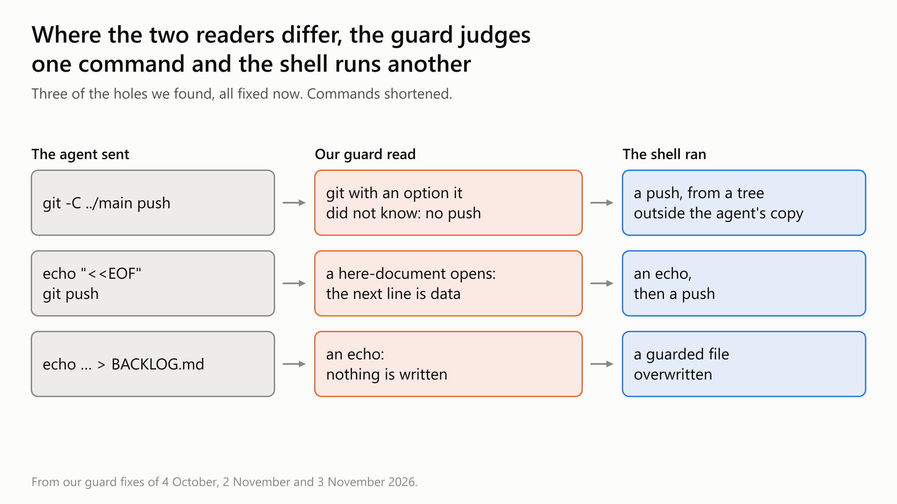
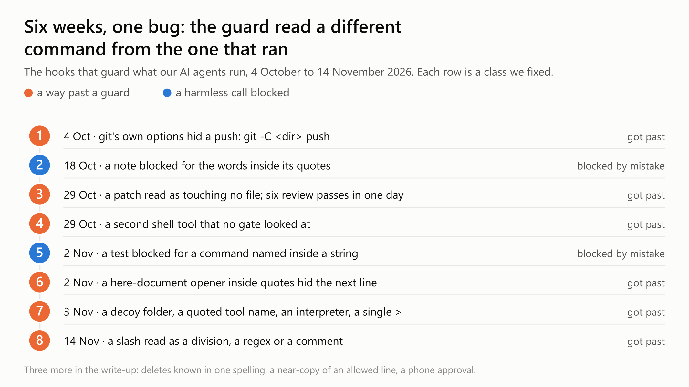
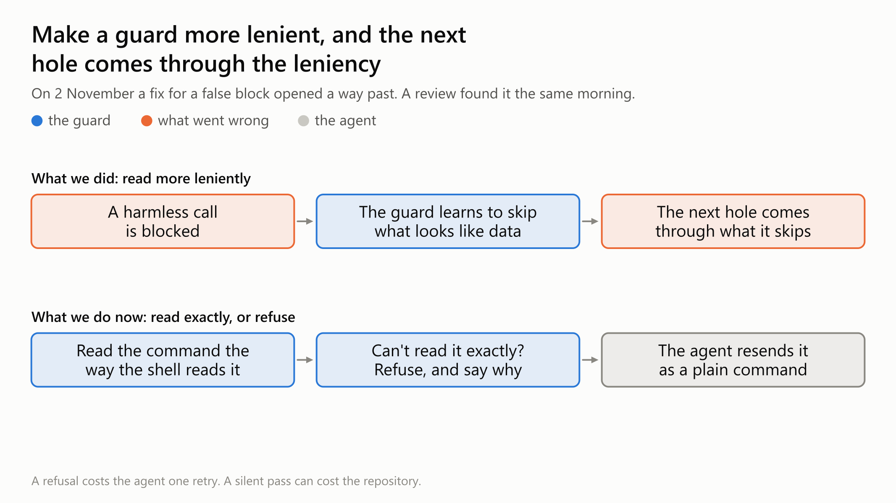
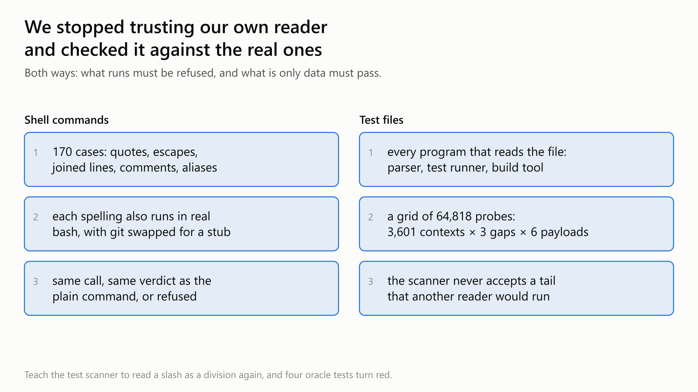
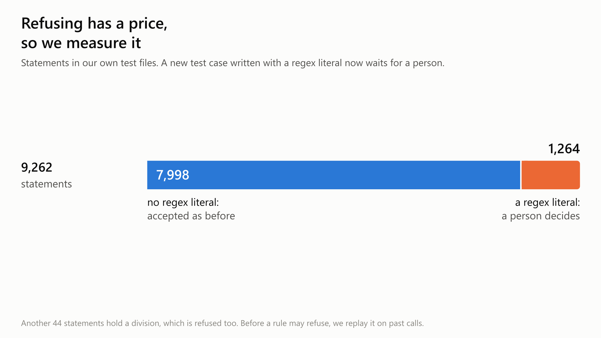
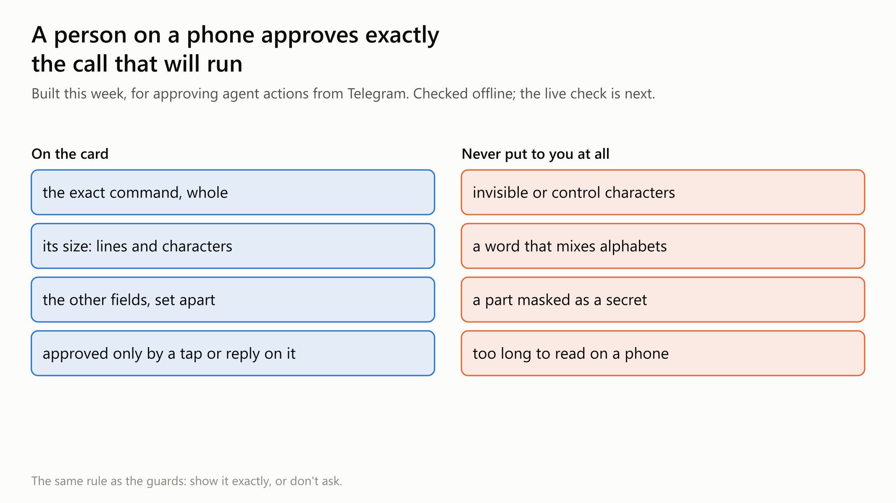

# Every hole in our agent's guards was the same bug

**English** · [Русский](README.ru.md)

*A short note from building SMA (Self-Mending Automation), a personal orchestrator for AI agents. The code is closed. The holes, the numbers and the rule that ended them are here.*

> **In short.** For six weeks, review after review found ways past the hooks that guard what our agents run. We patched each one, and more kept coming. They were all the same bug: the guard read a different command from the one the shell ran. Patching could not end it, because a lenient reader differs from the real one in endlessly many places, and loosening a guard to stop false blocks let the next hole in. What ended it was a change of default: read a command exactly the way the shell will, or refuse it. A reading difference now costs a refusal, never a silent pass. We check our reader against the real shell and the real parser, in both directions, and we measure what the refusals cost.

---

## The problem

Our agents run commands on their own. Before each command runs, a hook reads it and decides. A push to the main branch, a delete outside the agent's own copy, a write to the file that switches a gate off: refused. Everything else: allowed.

The hook reads the command as text. The shell reads it by its own rules: quotes, escapes, here-documents, options before the verb, programs that run other programs. Wherever the two readings differ, the guard judges one command while the shell runs another. Security people call this a parser differential.

---

## Six weeks of the same bug

Each entry is a class we found and fixed between 4 October and 16 November 2026.

- **4 Oct.** `git -C <dir> push`: git's own options stood before the verb, and the guard never saw the push.
- **18 Oct.** A note was blocked because of the words inside its quotes. We taught the guard that quoted text is data, except for programs that run it. Within the hour we flipped the list: quoted text is now data only for a short list of programs known *not* to run it, such as echo, printf and grep. A list of dangerous programs is a list of the ones you forgot.
- **29 Oct.** A gate for the patch format of our second coding agent read a non-empty patch as touching no file, and let it through. Six review passes in one day kept finding ways past it. On the third pass we rebuilt the gate to read only the format's exact grammar and refuse everything else.
- **29 Oct.** The gates judged one shell tool. The agent had two.
- **2 Nov.** A test was blocked because it named a command inside a string. The fix taught the reader to set aside data such as here-documents. The same morning, a review found a here-document opener inside quotes, which to bash is plain text: our reader treated the next line as data, though bash runs it. Digging in, we found the same search in four readers, ending data blocks on lines that only looked like their delimiter. Its own comment called that "a safety margin".
- **3 Nov.** Five days after the patch gate went strict, a dedicated review found four more ways past it: a decoy working directory, a quoted or escaped tool name, an interpreter writing the file, and a single `>`. Reading one format strictly had moved the holes to the parts we still read loosely.
- **8 Nov.** Each kind of recursive delete was recognised in one spelling only. Flag order, spacing and quoting changed the verdict.
- **10 Nov.** One line was let past a gate by parsing it, and a near-copy walked around the parser. Now the line must match exactly, and 29 near-copies are refused.
- **14 Nov.** A scanner that lets an agent append test cases guessed whether a slash starts a regex, a division or a comment. The guess was narrowed twice, and the reports kept coming. It now makes no guess at all.
- **16 Nov.** The newest case sits at the human end: an approval on a phone that shows something other than what will run. We built the approval card around this rule from the start, and three review rounds still found gaps in it.

---

## Why patching did not work

A lenient reader differs from the real one in endlessly many places. Each patch closes one and leaves the rest open.

The misreading also cuts both ways. The same guards that let a hidden push through also blocked a harmless note and a test, because a word in their data looked like a command. Blocking harmless work is the pressure that makes you loosen a guard, and loosening is how the next hole gets in.

---

## The rule that ended it

1. **One reader for every guard.** Not a regex per guard, but one shared reader that reads the way the shell does. Quotes, escapes and joined lines are resolved first. A here-document opens only where bash opens one and ends only on the line that is exactly its delimiter. Wrappers such as `bash -c`, `eval`, `xargs`, `env` and `ssh` are read through to the command they run.
2. **What it cannot read exactly, it refuses, and it says why.** The refusal asks for the plain form of the command. A reading difference now costs one retry, never a silent pass.
3. **Allow-lists, not deny-lists.** Quoted text is data only for programs known not to run it. Every tool is judged unless it is on a short read-only list. A hook matcher that names the tools to judge is a list of the tools you forgot.
4. **For a format you must parse, accept only its narrowest form.** Our patch gate reads only the format's exact grammar. Our test scanner reads `//` and `/*` as the start of a comment, as the engine does after any token, and refuses every other slash.
5. **A person approves exactly what runs.** If a call cannot be shown whole and as it is, nobody is asked to approve it.

---

## How we check a guard

We stopped trusting our own reader and started comparing it with the real ones.

- **Shell commands: 170 cases.** Each spelling of a command (quotes, escapes, ANSI-C strings, braces, joined lines, comments, aliases) must get the same verdict as its plain form. Unreadable ones must be refused. Harmless ones that must stay allowed are pinned. The spellings also run in real bash, with git swapped for a stub, and must print the same call as the plain command.
- **Test files.** The scanner is held against every program that reads a test file: the parser our test runner uses, the runner itself and the build tool. A grid of 64,818 probes (3,601 token contexts × 3 gaps × 6 payloads) checks that whatever the scanner accepts, the real parser reads the same way. Teach the scanner to read a slash as a division again, and four oracle tests turn red.
- **Both directions.** What runs must be refused, and what is only data must pass. The here-document hole slipped past our own 36-form probe because no probe put the push on a line after an opener.

---

## What it costs

Refusals. In our own test files, 1,264 of 9,262 statements hold a regex literal and 44 hold a division. A new test case written that way no longer goes in on its own; it waits for a person. A new case can use `new RegExp('…')` instead, and the hints to the agent say so.

Before a rule may refuse anything, we replay it on our history: 155,689 past agent calls. A rule refuses only where every labelled hit was right. Everywhere else it only warns.

---

## The person at the end of the line

This week we started approving agent actions from Telegram, and the same rule applies to a human reader. The card shows the exact command, whole, with its size, and the other fields set apart. A call with invisible or control characters, a word that mixes alphabets, a part that would be masked as a secret, or more text than fits on a phone is never put to anyone; it is refused. Only a tap or a reply on that card counts, and only for that call.

---

## What this does not show

- **The class is not closed for good.** Making one format strict moved the holes to the parts we still read loosely. Every new reader is a new place to differ.
- **A hook is not a wall.** A hook runs as your user, so anything else running as your user can switch it off or feed it lies. The wall that holds is a separate operating-system user, which is how our autonomous workers run.
- **The phone approval is checked offline only,** and its last review left two known gaps open. The live check is next.
- **One project, six weeks, and reviews we ran ourselves.** The numbers are ours.

---

## Questions for you

- What does your guard do with a command it cannot parse: let it through, or refuse it?
- Have you ever checked your guard's reader against the real shell, in both directions?
- When a guard blocks something harmless, do you make it more lenient, or make it say why?

---

*Written by Matvey. Text: [CC BY 4.0](../LICENSE). This repository contains ideas only, no code.*
