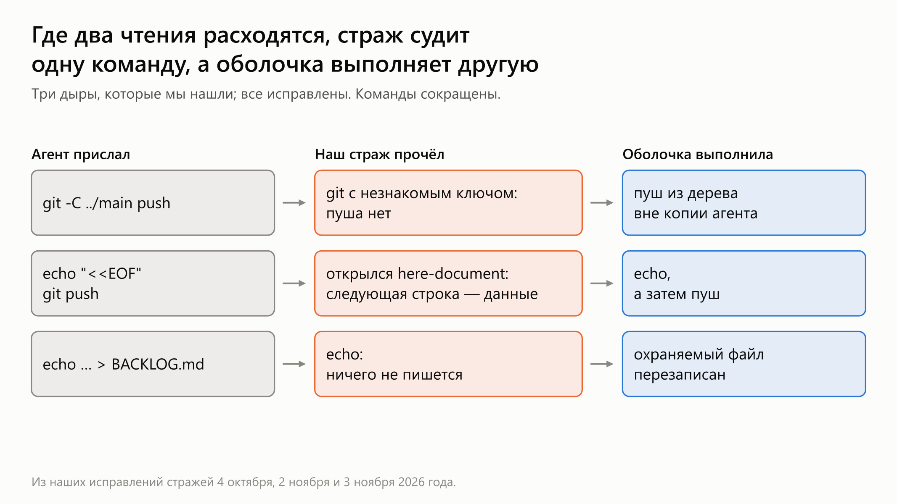
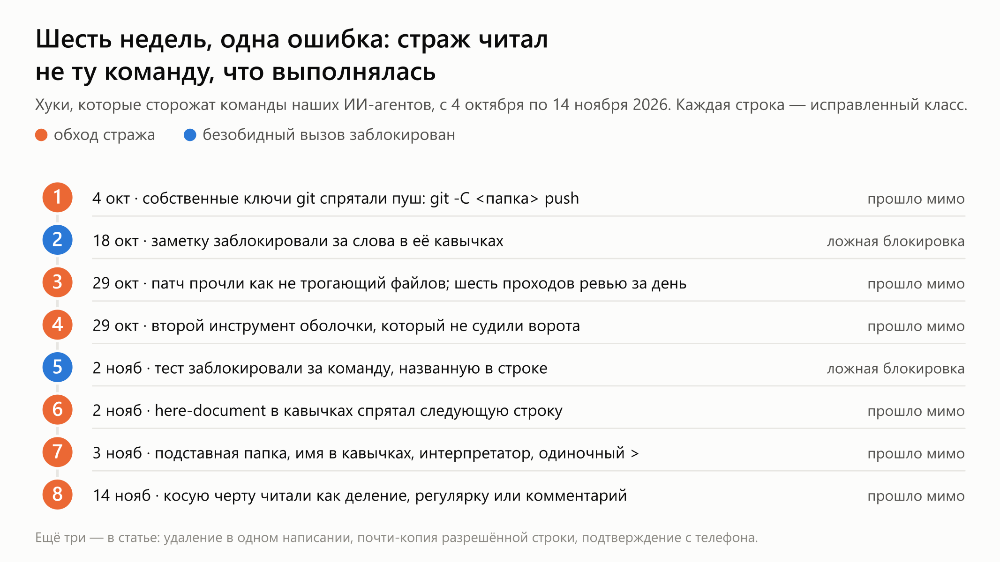
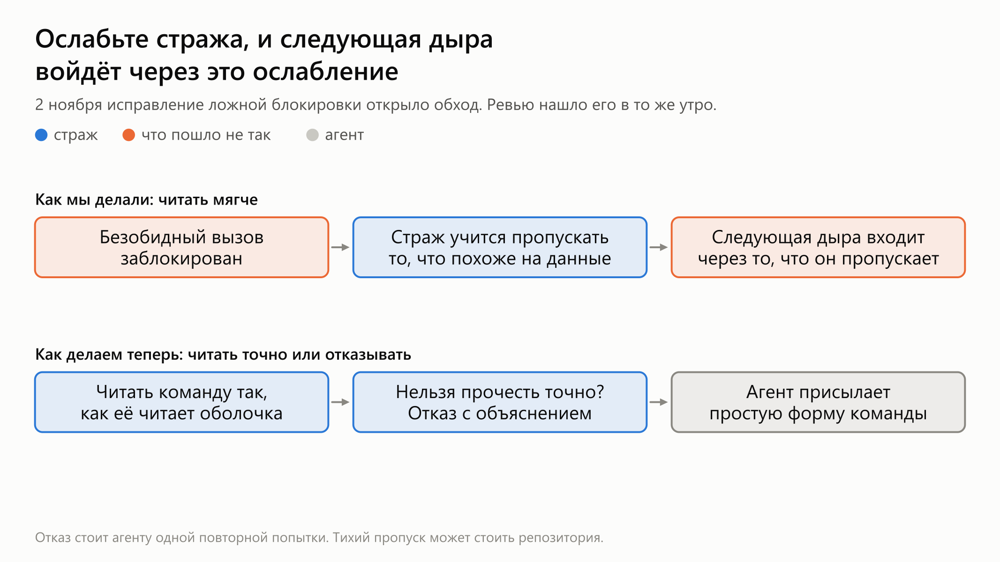
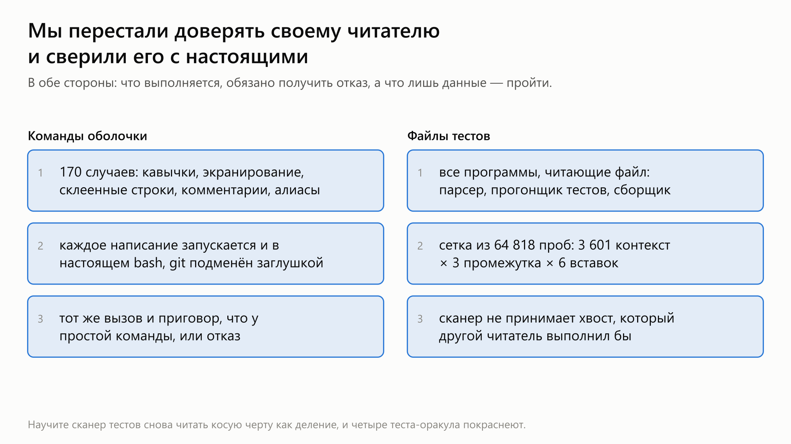
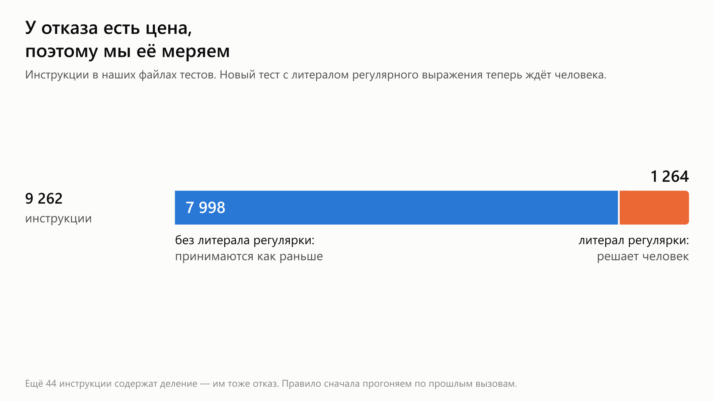
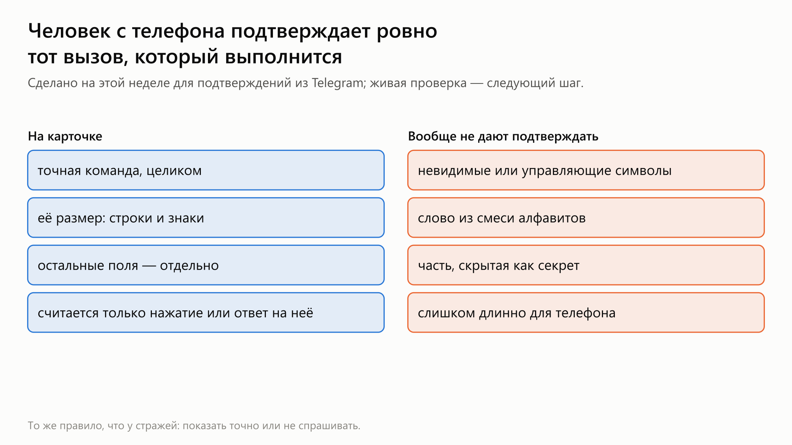

# Все дыры в стражах нашего агента оказались одной ошибкой

[English](README.md) · **Русский**

*Короткая заметка о том, как мы строим SMA (Self-Mending Automation), личный оркестратор для ИИ-агентов. Код закрыт. Здесь дыры, цифры и правило, которое их прекратило.*

> **Коротко.** Шесть недель ревью за ревью находило, как обойти хуки, которые сторожат команды наших агентов. Мы латали каждую дыру, и появлялись новые. Все они были одной ошибкой: страж читал не ту команду, которую выполняла оболочка. Заплатки не могли это прекратить: мягкий читатель расходится с настоящим в бесконечном числе мест, а ослабление стража ради ложных блокировок впускало следующую дыру. Прекратила это смена умолчания: читать команду ровно так, как её прочтёт оболочка, или отказывать. Расхождение в чтении теперь стоит отказа, а не тихого пропуска. Мы сверяем своего читателя с настоящей оболочкой и настоящим парсером в обе стороны и меряем, сколько стоят отказы.

---

## Задача

Наши агенты сами запускают команды. Перед каждой командой её читает хук и решает. Пуш в главную ветку, удаление вне своей копии, запись в файл, который выключает ворота, — отказ. Остальное можно.

Хук читает команду как текст. Оболочка читает её по своим правилам: кавычки, экранирование, here-document, ключи перед глаголом, программы, которые запускают другие программы. Где два чтения расходятся, страж судит одну команду, а оболочка выполняет другую. В безопасности это называют parser differential — расхождением парсеров.

---

## Шесть недель одной ошибки

Каждый пункт — класс, который мы нашли и исправили между 4 октября и 16 ноября 2026 года.

- **4 окт.** `git -C <папка> push`: собственные ключи git стояли перед глаголом, и страж не видел пуша.
- **18 окт.** Заметку заблокировали за слова внутри её кавычек. Мы научили стража, что текст в кавычках — это данные, кроме программ, которые его выполняют. В течение часа перевернули список: теперь текст в кавычках считается данными только для короткого списка программ, которые его заведомо *не* выполняют, вроде echo, printf и grep. Список опасных программ — это список тех, о которых забыли.
- **29 окт.** Ворота для формата патчей нашего второго агента-программиста прочли непустой патч как не трогающий ни одного файла и пропустили его. Шесть проходов ревью за один день раз за разом находили обходы. На третьем проходе мы пересобрали ворота: читать только точную грамматику формата, всё остальное — отказ.
- **29 окт.** Ворота судили один инструмент оболочки. У агента их было два.
- **2 нояб.** Тест заблокировали за то, что он называл команду внутри строки. Исправление научило читателя откладывать в сторону данные вроде here-document. В то же утро ревью нашло открывающий here-document внутри кавычек, а для bash это просто текст: наш читатель счёл следующую строку данными, хотя bash её выполняет. Копнув, мы нашли тот же поиск в четырёх читателях: он заканчивал блок данных на строке, которая лишь похожа на разделитель. Его собственный комментарий называл это «запасом прочности».
- **3 нояб.** Через пять дней после того, как ворота патчей стали строгими, отдельное ревью нашло ещё четыре обхода: подставная рабочая папка, имя инструмента в кавычках или с экранированием, интерпретатор, который пишет файл, и одиночный `>`. Строгое чтение одного формата перенесло дыры туда, где мы ещё читали мягко.
- **8 нояб.** Каждый вид рекурсивного удаления узнавался только в одном написании. Порядок ключей, пробелы и кавычки меняли приговор.
- **10 нояб.** Одну строку пропускали через ворота, разбирая её, и почти-копия обошла разбор. Теперь строка должна совпасть точно, а 29 почти-копий получают отказ.
- **14 нояб.** Сканер, который разрешает агенту дописывать тесты, угадывал, с чего начинается косая черта: с регулярного выражения, деления или комментария. Догадку дважды сужали, а отчёты продолжали приходить. Теперь он не угадывает вовсе.
- **16 нояб.** Самый новый случай — на человеческом конце: подтверждение с телефона, которое показывает не то, что выполнится. Карточку подтверждения мы строили по этому правилу с самого начала, и всё равно три круга ревью нашли в ней щели.

---

## Почему заплатки не сработали

Мягкий читатель расходится с настоящим в бесконечном числе мест. Каждая заплатка закрывает одно из них и оставляет остальные открытыми.

К тому же ошибка чтения режет в обе стороны. Те же стражи, что пропускали спрятанный пуш, блокировали безобидную заметку и тест: слово в их данных было похоже на команду. Блокировка безобидной работы — это давление, которое толкает ослабить стража, а через ослабление и входит следующая дыра.

---

## Правило, которое это прекратило

1. **Один читатель для всех стражей.** Не своё регулярное выражение у каждого стража, а один общий читатель, который читает так, как оболочка. Сначала разбираются кавычки, экранирование и склеенные строки. Here-document открывается только там, где его открывает bash, и закрывается только строкой, в точности равной разделителю. Обёртки вроде `bash -c`, `eval`, `xargs`, `env` и `ssh` читаются насквозь, до команды, которую они запускают.
2. **Что нельзя прочесть точно, получает отказ, и страж объясняет почему.** Отказ просит простую форму команды. Расхождение в чтении теперь стоит одной повторной попытки, а не тихого пропуска.
3. **Списки разрешённого, а не запрещённого.** Текст в кавычках — данные только для программ, которые его заведомо не выполняют. Судится каждый инструмент, кроме короткого списка тех, что только читают. Матчер хука, который перечисляет, какие инструменты судить, — это список забытых инструментов.
4. **Для формата, который приходится разбирать, принимать только самую узкую форму.** Ворота патчей читают только точную грамматику формата. Сканер тестов читает `//` и `/*` как начало комментария (так их читает движок после любого токена) и отказывает любой другой косой черте.
5. **Человек подтверждает ровно то, что выполнится.** Если вызов нельзя показать целиком и как есть, его никому не дают подтверждать.

---

## Как мы проверяем стража

Мы перестали доверять своему читателю и стали сверять его с настоящими.

- **Команды оболочки: 170 случаев.** Каждое написание команды (кавычки, экранирование, строки ANSI-C, фигурные скобки, склеенные строки, комментарии, алиасы) обязано получить тот же приговор, что её простая форма. Нечитаемые получают отказ. Безобидные, которые должны проходить, закреплены. Написания ещё и запускаются в настоящем bash, где git подменён заглушкой, и обязаны напечатать тот же вызов, что простая команда.
- **Файлы тестов.** Сканер сверяется со всеми программами, которые читают файл теста: с парсером нашего прогонщика тестов, с самим прогонщиком и со сборщиком. Сетка из 64 818 проб (3 601 контекст токена × 3 промежутка × 6 вставок) проверяет, что всё, что сканер принимает, настоящий парсер читает так же. Научите сканер снова читать косую черту как деление, и четыре теста-оракула покраснеют.
- **В обе стороны.** То, что выполняется, обязано получить отказ, а то, что лишь данные, обязано пройти. Дыра с here-document проскочила мимо нашей собственной пробы из 36 форм, потому что ни одна проба не ставила пуш на строку после открывающего.

---

## Сколько это стоит

Отказы. В наших собственных файлах тестов 1 264 из 9 262 инструкций содержат литерал регулярного выражения и 44 — деление. Новый тест, написанный так, больше не проходит сам: он ждёт человека. Вместо литерала новый случай может написать `new RegExp('…')`, и подсказки агенту об этом говорят.

Прежде чем правилу разрешат отказывать, мы прогоняем его по истории: 155 689 прошлых вызовов агентов. Правило отказывает только там, где каждое размеченное срабатывание было верным. В остальных местах оно только предупреждает.

---

## Человек на конце провода

На этой неделе мы начали подтверждать действия агентов из Telegram, и то же правило работает для человека-читателя. Карточка показывает точную команду целиком, с её размером, а остальные поля — отдельно. Вызов с невидимыми или управляющими символами, со словом из смеси алфавитов, с частью, которую пришлось бы скрыть как секрет, или с текстом длиннее, чем помещается на телефоне, никому не показывают: он получает отказ. Считается только нажатие или ответ на эту самую карточку, и только для этого вызова.

---

## Чего это не показывает

- **Класс не закрыт навсегда.** Строгость одного формата перенесла дыры туда, где мы ещё читали мягко. Каждый новый читатель — новое место для расхождения.
- **Хук — не стена.** Хук работает от вашего пользователя, поэтому всё, что работает от вашего пользователя, может его выключить или скормить ему ложь. Стена, которая держит, — отдельный пользователь операционной системы; так работают наши автономные работники.
- **Подтверждение с телефона проверено только без живого прогона,** и последнее ревью оставило две известные щели открытыми. Живая проверка — следующий шаг.
- **Один проект, шесть недель и ревью, которые мы проводили сами.** Цифры наши.

---

## Вопросы к вам

- Что делает ваш страж с командой, которую не может разобрать: пропускает её или отказывает?
- Вы когда-нибудь сверяли читателя своего стража с настоящей оболочкой, в обе стороны?
- Когда страж блокирует безобидное, вы делаете его мягче или заставляете объяснить почему?

---

*Автор: Матвей. Текст: [CC BY 4.0](../LICENSE). В этом репозитории только идеи, без кода.*
