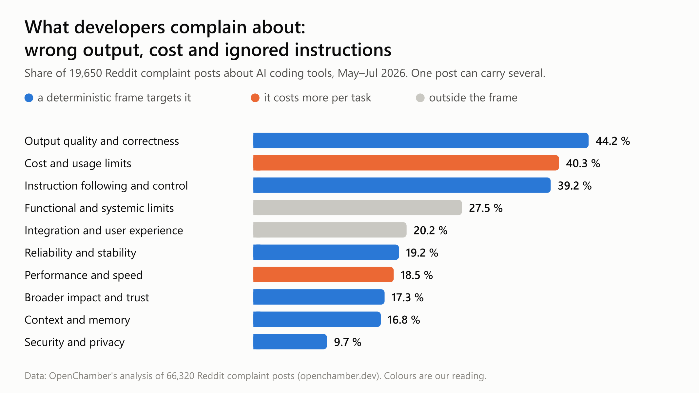
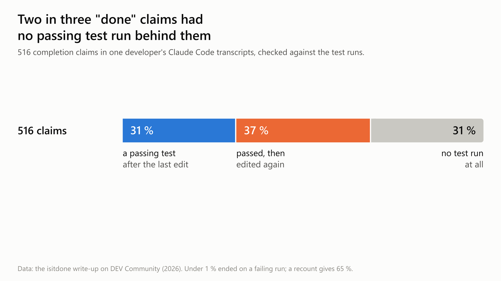
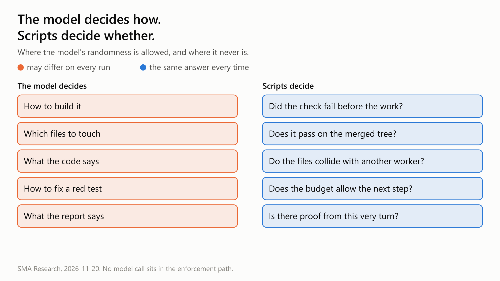
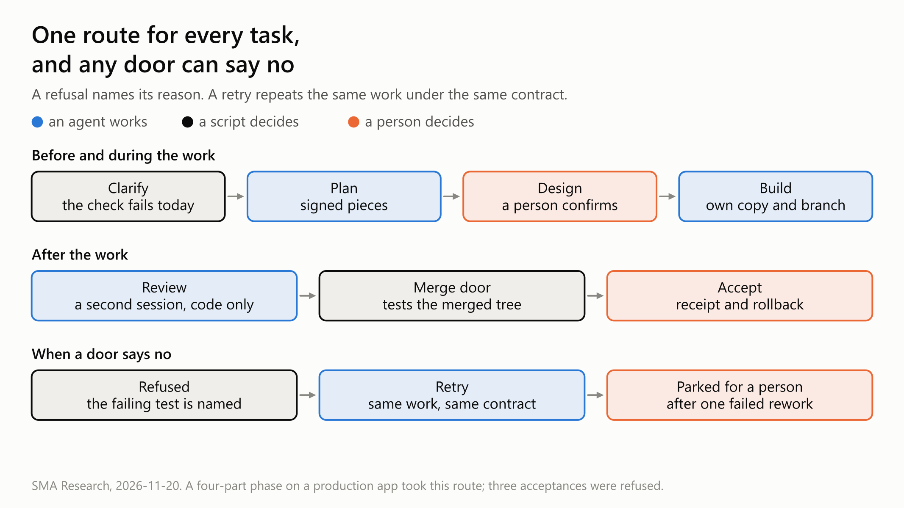
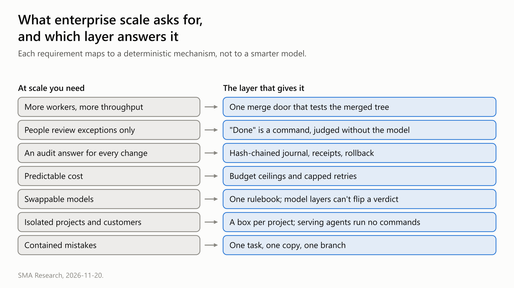
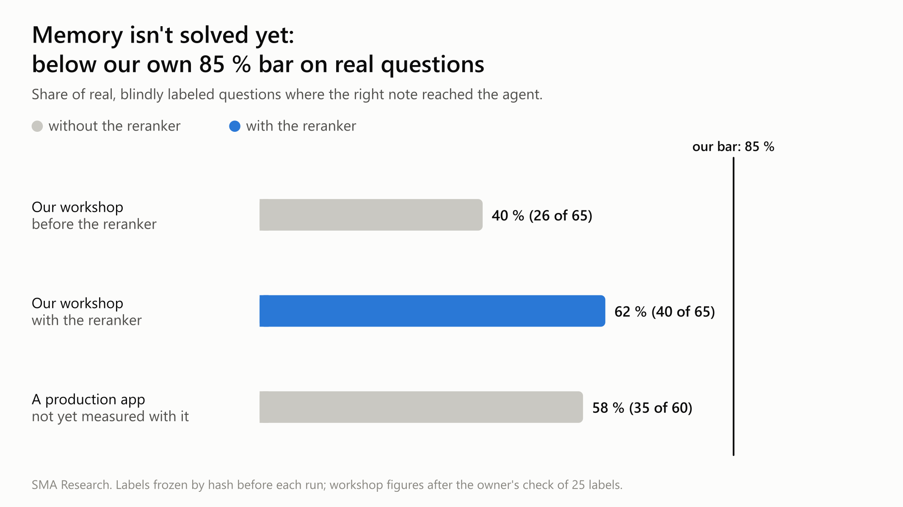

# The model is the unreliable part. Build around it like a network engineer would.

*A note from building SMA (Self-Mending Automation), a personal orchestrator for AI agents. The code is closed. The ideas, the numbers and what is not proven yet are here.*

---

Most work on AI coding agents tries to make the model more reliable: better prompts, bigger context, smarter models. We've spent the past few months doing the opposite. We assumed the model will never be deterministic, and made everything around it deterministic instead.

This isn't a new idea. It's the oldest trick in systems engineering.

## What people actually complain about

Before the how, the why. An independent analysis of 66,320 Reddit complaint posts about AI coding tools, from August 2025 to September 2026, ranks the problems. The top three: output quality and correctness (44% of complaint posts in May–July 2026), cost and usage limits (40%), and instruction following and control (39%).

A survey of 554 engineers who already use agents, run by Temporal in spring 2026, adds two more numbers. 41% run into problems with their agents daily or more often. The most common blocker to running more agents isn't the model. It's tracking state, named by 36%.

And one developer counted what "done" means. Across 516 completion claims in their own Claude Code transcripts, only 31% had a passing test run after the last edit. 37% passed and were then edited again. 31% had no test run at all.

Look at what's missing from the top of those lists: raw intelligence. Most of the pain is about trust. Wrong output nobody caught, instructions that didn't stick, state nobody can follow, a "done" with nothing behind it. You can't prompt those away, because they aren't model problems. They're protocol problems.

One complaint we won't pretend to fix: cost. Everything below makes a single task more expensive, not less. More on that at the end.

## 1. Reliable systems are built on unreliable parts

IP loses packets; TCP on top of it doesn't. Disks fail; databases on top of them don't lose committed data. Message queues deliver twice; well-built services still apply each payment exactly once.

Nobody fixed the network or the disk. Engineers put a deterministic protocol around the unreliable part: sequence numbers, checksums, write-ahead logs, idempotency keys, retries with backoff.

An LLM is the same kind of component: powerful, and unreliable in exactly the way a lossy channel is. Ask twice, get two answers. Ask it whether it's done, and it may say yes when it isn't.

So the question to ask isn't "how do I make the model deterministic?" It's "what protocol makes the *outcome* deterministic, whatever the model does?"

## 2. Why this works on tasks nobody has a template for

The usual objection: determinism is fine for templated work, but real tasks are novel.

Here's the asymmetry that answers it. For most real work, **checking a result is far easier than producing it.** You may not know how to build the feature, but you can say what has to be true when it exists. You may not know where the bug is, but you can write the command that shows it.

So put the determinism on the checking side. Before any work starts, the daemon that dispatches our agents runs the task's check against today's code. For a new feature, the check must fail now; the work's whole job is to make it pass. For a refactor, the check must pass now and keep passing. A task whose finish line can't fail isn't admitted.

A novel task doesn't need a template. It needs a finish line that can fail.

## 3. The layers of the protocol

### Layer 1: the finish line is written before the work

Every plan pre-registers what will measurably change and the command that checks it. At the end, a script re-runs that command and writes hit or miss to a ledger. A feature can't become a default until it declares five things up front: the failure it fixes, a baseline measured *before* the change, a numeric prediction, the acceptance check and the rollback.

*Why it scales:* when "done" is a command, anyone (a person, another agent, a CI job next year) gets the same answer.

### Layer 2: no model in the enforcement path

Gates, verdicts and receipts are plain scripts. A receipt's hash is computed from the exact command, its exit code and its normalized output, so two different checks can never share one. The work journal is hash-chained: every line carries the hash of the line before it, and the chain's tip is pinned into the release tag. Edit history, and verification fails.

*Why it scales:* the part that decides is the part you can audit, replay and trust under pressure.

### Layer 3: the judge never reads the defendant's report

A second agent, in a separate session that sees only the code, decides whether the work is done. By design, it never receives the worker's own summary. Its verdict has a fixed shape, and only receipts the daemon itself produced count as evidence; a sentence in a verdict is not evidence.

Then the grader gets graded. We plant known false "dones" and track how many the verifier catches. Below a 90% catch rate, "zero problems found" is treated as evidence of a lazy verifier, not of good work.

*Why it scales:* trust stops depending on who wrote the code, model or human.

### Layer 4: a state machine, not a chat

Every unit of work moves through explicit stages: clarify, plan, design, build, verify, accept. Each stage has a gate in one of three states: *needed*, *confirmed* or *not needed*. "Not needed" is its own state on purpose: a stage someone chose to skip and a stage someone signed off on look the same on a card and mean opposite things. The design gate has no flag that turns it off, and editing what the work promises sends the gate back to "needed".

Every state change carries a key derived from the task, the attempt and the transition. No clock, no counter. A redelivered message, a double click or a restart can't apply a change twice. Only one attempt holds a task at a time, and a stale holder is refused by a fencing token. Side effects follow a write-ahead pattern: record the intent, do the effect, record the result. After a crash, the daemon checks what already happened before acting again. We test this by hard-killing a real daemon over a real database and counting what's left.

*Why it scales:* at a thousand tasks a day, "it crashed halfway" stops being an incident and becomes a resumed state.

### Layer 5: concurrency by construction

Many workers on one repository is where agent setups usually fall apart. Ours share four rules:

- Every scope a worker edits is **claimed**, and a collision raises a warning before the first edit.
- Anything two workers could race on (a migration number, a release version) comes from **one shared counter**.
- The queue **refuses** to hand out two tasks that declare the same files.
- Everything reaches the main branch through **one serialized merge door**. It merges without committing, runs the tests on the *merged* tree, and only then commits. A red run is refused with the failing test named.

Budget limits read the same number the dashboard shows, and an action that would cross the ceiling never starts.

*Why it scales:* adding a worker adds throughput instead of adding conflicts.

### Layer 6: everything can be undone

Every attempt runs in its own copy, on its own branch, cut from a known commit. Its journal records that base commit, every changed file, deletions as their own list, and one copy-paste command that undoes the whole attempt. That includes the attempts that failed. A failure that a plain retry can fix is retried automatically, with a cap and a pause that doubles each time. A defect that survives one rework is parked for a person, never dispatched a third time.

*Why it scales:* the blast radius of any agent mistake is one branch, and the way back is written down before anyone needs it.

### Layer 7: context is a function, not luck

What the agent knows should depend on the task, not on chance. Memory comes in three tiers: a small core that always loads, topic notes that load when a task touches their tags, and "reflexes": single lessons wired into the exact tool call they protect. Hard filters run before any ranking: status, validity window, sensitivity, scope. Staleness is a comparison of stamps, not a judgment call. Every new note goes through one pipeline of fixed steps, and which approval it needs is a pure function of four fields.

Optional intelligence sits on top without owning correctness. A model can reorder candidate notes, but it can't add or drop one, and when it stays silent the order is byte-for-byte what it would have been. On our own real questions, that reranker lifted the right note into the agent's prompt from 26 to 40 cases out of 65.

*Why it scales:* the same task gets the same context, on every machine and for every teammate.

### Layer 8: honesty is a data type

At scale, the most expensive failure isn't a red test. It's a green that means nothing. So every state gets its own encoding:

- A check that couldn't run exits with its own code and prints NOT RUN. An empty list of findings never reads as "clean".
- A test runner answers *ran*, *refused* or *cut off*. "No result" is never folded into "passed".
- Missing data is a failure that names what's missing.
- A calibration badge hides itself after a model change until there's enough new data.
- A claimed pass that the blind verifier reproduces as a failure blocks the next release until a human records a decision, in a ledger the agent can't edit.
- And the one we hit most: the agent can't tell you what's true *now* without proof from *now*. A hook reads its final answer, and a statement about current state with no command output from that turn sends it back to run the check.

### Layer 9: every failure class becomes a mechanism

A rule written in a prompt is a wish. A rule enforced by a hook is a fact. When something breaks, we don't add a sentence to the instructions. We name the class of failure and close it with a mechanism, a gate or a test, then sweep the whole codebase for other instances of the same class. Our log holds 46 such failures, sorted into 10 classes.

*Why it scales:* the same class of mistake doesn't come back. A class closed once stays closed for every project and every model.

## 4. Why this is what enterprise scale actually needs

Making a single agent good at a single task is a demo. Enterprise scale means hundreds of tasks across many repositories, many teams, years of history and auditors. Each requirement maps to a layer:

- **Throughput grows with workers** only if merges are serialized and verified (Layer 5).
- **Human attention stops being the bottleneck** only if acceptance can be delegated, and acceptance can be delegated only when "done" is machine-checked (Layers 1–3). People review exceptions, not every task.
- **Audit and compliance** need an answer, for every change, to "who changed what, on what evidence, and how do we undo it?" (Layers 2 and 6).
- **Predictable cost** needs budget ceilings, capped retries and limits that only rise on purpose (Layers 4–6).
- **Model independence**: the protocol is the asset, the model is a part. One rulebook feeds every model we run, and optional model layers can't change a verdict.
- **Isolation**: every project or customer gets its own box: own user, own daemon, own keys. An agent that serves other people runs no commands at all; a deterministic gateway does the reading for it. We also learned, from measured outages, never to share one model account between projects.
- **Failure containment**: one task, one copy, one branch, one rollback command.

This is also the direct answer to the survey's top blocker. "Tracking state" stops being a problem when every unit of work is a row in a state machine with a journal, instead of a conversation someone has to reread.

## 5. What we're building next

All of these are planned and not shipped yet:

- **The same engine inside an online platform.** Many workers, roles, approvals in the browser and on the phone, with the same gates.
- **A backlog that works itself.** The daemon takes items one by one around the clock, and each one still has to pass the full route.
- **Self-improvement behind a gate.** Research produces a hypothesis, the hypothesis runs against the stable version, and it's adopted only if it wins on the measurement. A report goes out either way.
- **Judgment as a measured policy.** An owner's past decisions are distilled into a policy. Before the policy may decide anything, it takes an exam on held-out real decisions it has never seen, and the list of decisions reserved for humans can only grow. The exam exists today; letting it gate adoption is the next step.
- **Engineering practices in any project.** Each practice comes with a measurable sign, a change, a risk and a check, and is adopted because the project's own measurements call for it, not because it's fashionable.
- **Estimates that learn.** The estimate made before the work is compared with the attempts, returns and hours after it, on one scale across all projects.

## 6. Honest numbers

- The last two releases went out on full runs of 21,908 and 22,289 tests, with zero failures.
- On one of our production apps, a four-part phase went through the whole route and was merged by the daemon itself. On the way, three acceptances were refused, each over a single red test.
- On November 20, a release of one of our apps hit a red test against a real database. The deploy waited on its own, production stayed on the previous version, and the fix shipped an hour later.
- Memory is not solved. On our own real, blindly labeled questions, the right note reaches the agent in 58–62% of cases, depending on the project. Our bar is 85%.

- A full phase doesn't yet run start to finish without a person.
- We don't publish a success rate for non-template tasks yet, because we haven't measured it in a way we'd defend. That number comes when it's honest.
- On a single task, all of this costs more: the checks, the second reviewer and the full test runs aren't free. The bet is cost per *correct* result across many tasks, and that's a number we still owe you, too.

The model is getting better every quarter. The protocol around it is what turns "better" into "dependable." Make the model the only non-deterministic part of your system, and keep it in a box where its mistakes can't reach anything without passing a check.

*Sources: OpenChamber, "A year of AI coding complaints" (openchamber.dev, 2026); Temporal, State of Development 2026 (554 engineers, April–May 2026); "69% of my coding agent's 'done' claims weren't" (DEV Community, 2026). Our own numbers come from our test runs and our claims registry.*

---

*Written by Matvey. Text: [CC BY 4.0](../LICENSE). This repository contains ideas only, no code.*
