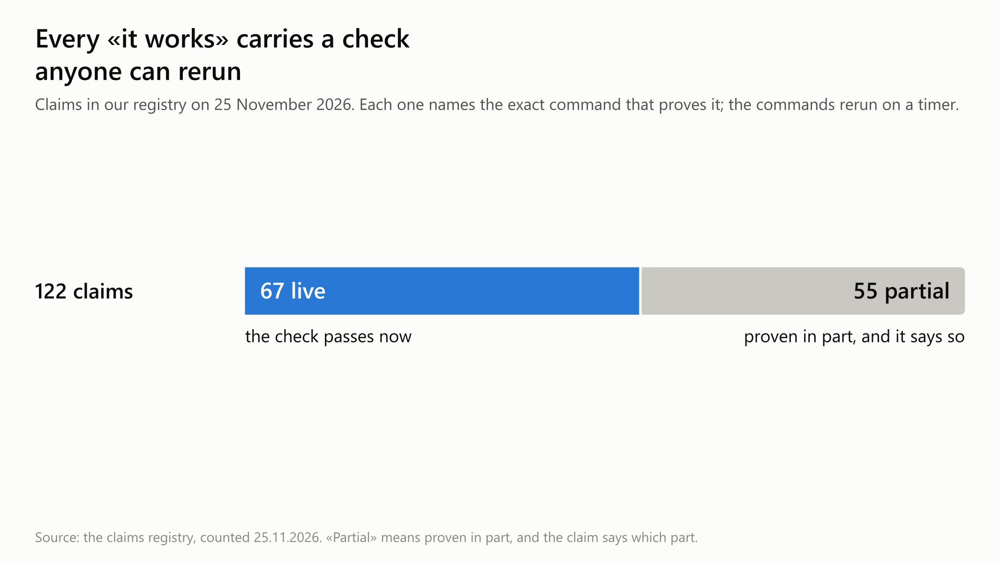
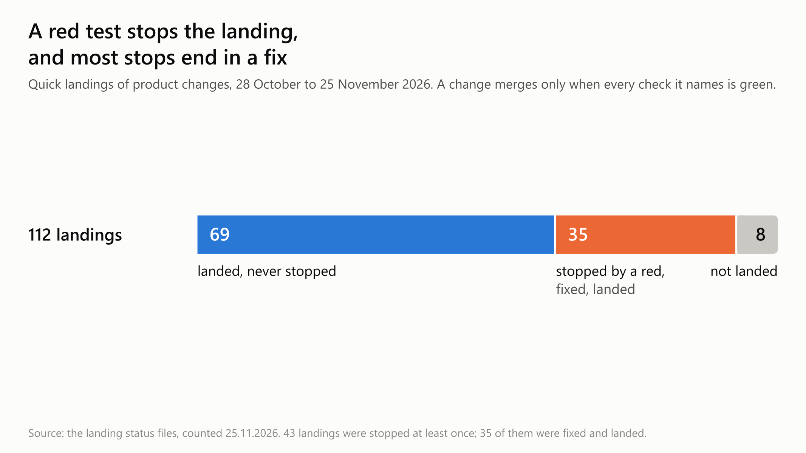
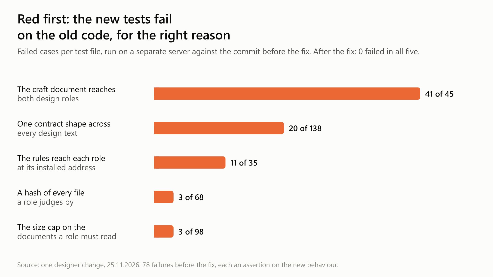
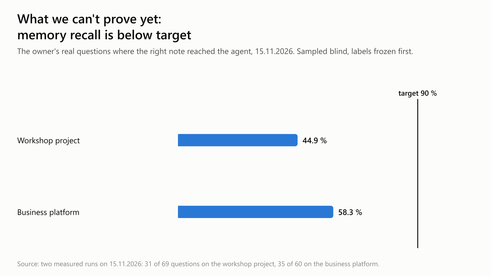

# Seven principles for an AI agent fleet you can actually trust

*A note from building SMA (Self-Mending Automation), a personal orchestrator for AI agents. The code is closed. The ideas, the numbers and what is not proven yet are here.*

---

I run a small company, and most of our software is now written by AI coding agents: Claude Code and Codex. Since July we've built a control layer around them, called SMA. It's a daemon that queues work and hands each task to a worker in its own copy of the code. It has a window where a person sees and accepts the work, and a memory that carries lessons from one task to the next.

The first months taught us one thing over and over: **a capable model is not the same as a reliable system.** Models keep getting better at deciding *how* to do something. Whether it was really done, safely, in a way you can undo, is a different question. Every time we left that question to the model, it eventually answered it wrong, and confidently.

So SMA follows one rule: **the model decides how; plain, boring mechanisms decide whether.** Here are the seven mechanisms that do most of that work. None of them is clever. That's the point.

## 1. A claim of "done" carries a check anyone can rerun

An agent's "done" is a sentence, and sentences are cheap. In SMA every claim that something works goes into a claims file, together with the exact command that proves it. The checks rerun on a schedule. Here is the entry for our latest release, trimmed:

```json
{
  "claim": "v5.12.0 is released: origin main and the tag point at the commit the full suite judged green",
  "run": ["node", "-e", "…git ls-remote origin refs/heads/main refs/tags/v5.12.0^{} … every line starts with 3409158d…"],
  "expectExit": 0,
  "state": "live"
}
```

A claim's state is one of three words: *live*, *partial* or *not checked*. "Partial" is an honest answer. "It works" with no command behind it is not an answer at all.



**Practice:** keep a claims file next to the code and rerun it on a timer. When a check fails, the claim goes back to "partial". Don't rewrite the claim so that it fits the check.

## 2. A run that didn't happen is never a pass

The most dangerous result in testing isn't red. It's an empty green: a suite that skipped everything, a check that never started, a screenshot step that swallowed its own error. Our verdict scripts treat "nothing ran" as a failure with its own name:

```js
if (passed === 0) {
  ok = false
  console.log(`not run: ${file} — 0 tests passed, ${skipped} skipped`)
}
```

Our UI driver has three exit codes: 0 for clean, 1 for blockers, and **3 for NOT RUN**. A missing browser is never a pass.

The rule cuts both ways. This week a landing spent a whole day re-running, on a laptop, a file that had passed completely on the server. Our verdict counted `todo` placeholders as "skipped". We fixed the count: a `todo` has no body and runs nowhere. A case that has a body and was skipped still sends its file to a second machine. The gate didn't get weaker; it got more precise.

**Practice:** make "not run" a third state in every check you own, and make it fail loudly.

## 3. Rules become mechanisms

A rule in a prompt is a wish. A hook that refuses is a rule. Whenever a person has to remind an agent of the same thing twice, we turn it into a gate that runs before the tool call. Three examples from one evening this week:

- **A task card for the remote fleet can't be written unless every promise names the exact command that checks it.** The file write itself is refused. The gate exists because early cards had free-form promises, and the worker turned out to be its own only judge.
- **A journal entry stamped with a time from the future is refused:** "19:20, but it is 19:09 now. Take the time from `date`, not from your head."
- **Shared counters are never read off the last number.** Release versions and backlog numbers come from one allocating command, because two parallel sessions will both pick "the next one".

The same idea runs through the whole release path. A change lands only when every check it names is green. When a check goes red, the landing stops, someone fixes the cause, and it runs again.



**Practice:** keep a list of what people had to say twice. Every entry becomes a gate, or a written decision that it never will be one.

## 4. Red first, and read the red

A test proves a fix only if it failed before the fix, and failed for the right reason. Our executors commit the new tests on their own, run them against the old code on a separate server, and only then write the fix.

This week one change to our designer did exactly that. On the commit before the fix, 78 cases failed across five files. Every failure line was the new promise, not a broken fixture:

```
AssertionError: expected [ …(2) ] to include 'references/design-craft.md'
```

Then the same files ran green on the fixed commit.



The second half of the rule matters as much as the first. A test that is red because its fixture crashed proves nothing, and we've been fooled by exactly that.

**Practice:** paste the failing line of the red run into the change description. If you can't, you haven't shown red.

## 5. Every piece of worker output can be undone with one command

A worker never touches the person's working tree. It writes only in its own copy, on its own branch, cut from a commit that is written down. The attempt journal records the base commit and the list of changed files, for failed attempts too:

```
task.attempt_files · base=3409158d… branch=wt/R-… files=0 (no changed files)
```

Accepting the work is a separate act, done by a person. "You can roll it back" and "you can see what to roll it back to" are two different promises. For weeks we kept only the first one.

**Practice:** one copy and one branch per task. Write the base commit and the changed files into the log before anyone looks at the result.

## 6. Memory enters through one door

An agent that remembers is only as good as what it is allowed to remember. In SMA a lesson enters memory one way, through a command:

```
node scripts/sma/cli.mjs memory write --type <kind> --truth <how-sure> --claim "<one claim>"
```

The command scrubs secrets before anything is saved, decides where the note belongs and keeps the index in step. When a person has to remind the agent of something that was already in memory, the miss is recorded as a test case:

```
node scripts/sma/cli.mjs memory miss --task "<what they asked>" --expected <note>
```

We measure recall on real questions, sampled blind, with the labels frozen before the run. Today it is below our target, and we know that because we measure it instead of feeling it.

**Practice:** one write path with scrubbing, and a test case for every miss. A memory you don't measure is a rumour.

## 7. People own the irreversible

Pushes to the main branch, tags, publishing, money, contracts and the agent's own permission settings belong to a person. The agent prepares, the person decides, and the decision reaches the person wherever they are: a card on their phone with a default, and the answer goes back into the session.

This week the release went out only after the full suite passed on a separate server. The update of our own tooling went differently: its installer would also change the configuration our safety hooks trust. That update was prepared in a copy and held for the owner, and the agent's guard wouldn't even let it read that file while he was away.

**Practice:** write down the short list of things only a person does, and enforce it with a hook, not with trust.

## How they fit

Follow one task through SMA. It goes into a queue. A worker takes it into its own copy. Checks run, and each one leaves a receipt. A second model criticises the result. A person accepts it. The lesson goes into memory through the one door. Every step in that chain is a mechanism you can point to, and none of them depends on the model having a good day.

## What we still can't prove



- Memory recall on real questions is below target: 31 of 69 questions on one project and 35 of 60 on another, against 90 %.
- The designer's taste loop hasn't yet been measured against the owner's own marks.
- We haven't counted how often an unusual task is accepted on the first try.

We'll publish those numbers when we have them, with the commands that produced them.

---

*Written by Matvey. Text: [CC BY 4.0](../LICENSE). This repository contains ideas only. The short excerpts above illustrate them; the code base stays closed.*
