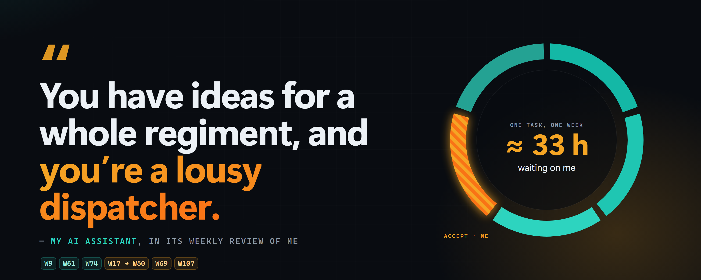
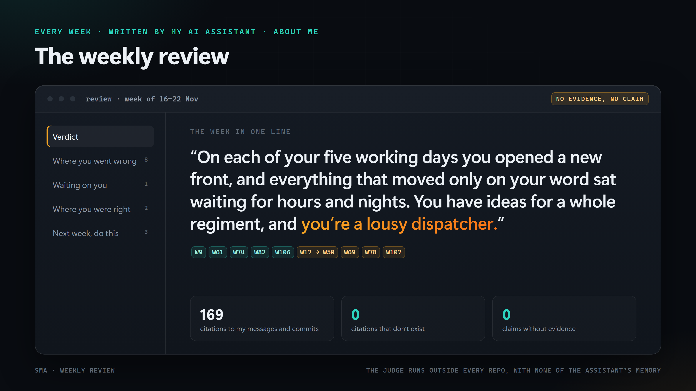
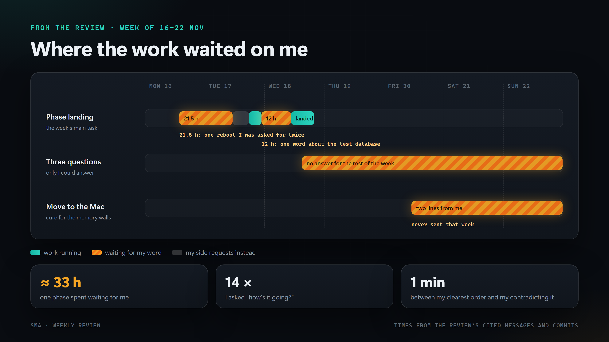
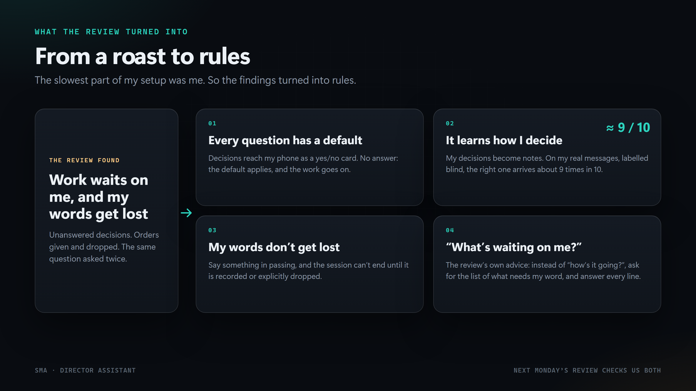
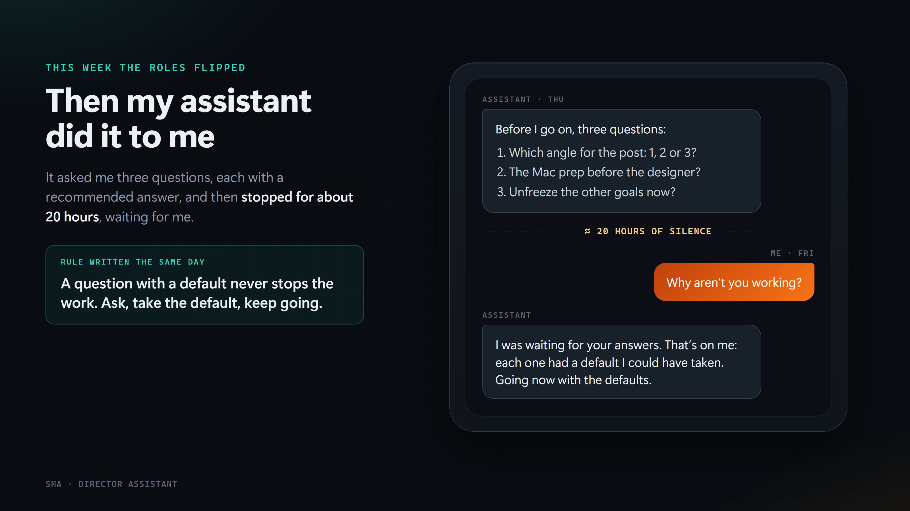
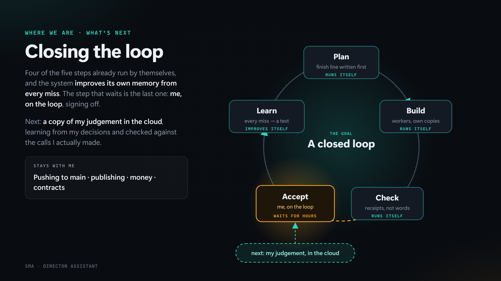

# My AI assistant reviews me every week. Last week it called me a lousy dispatcher.

*A note from building SMA (Self-Mending Automation), a personal orchestrator for AI agents. The code is closed. The ideas, the numbers and what is not proven yet are here.*

---

Every Monday, my AI assistant writes a review. Not of the code. Of me.

Last week's verdict, in one line:

> "On each of your five working days you opened a new front, and everything that moved only on your word sat waiting for hours and nights. You have ideas for a whole regiment, and you're a lousy dispatcher."

It was right. And it had receipts.

This note is about that review: how it's built, what it found, and why it changed what we're building. The short version: models are now good enough that the slowest part of my setup is me. So the goal has become a closed loop, one where the work no longer waits for a person to sign it off.

## How the review is built

I asked for it in October, in roughly these words: *show me where I made the wrong calls, and be harsher about it.* It ran daily at first. Now it runs once a week, for the week that just ended.

**What it reads.** Four sources, all local:

- every message I typed to my assistant that week. We keep our own record of them, because the tool's transcripts don't live forever;
- for each message, the end of the assistant's reply I was answering, so a terse "yes" has its question beside it;
- the list of things waiting for my decision;
- the week's commits and landings.

**What it writes.** Five sections, always the same:

1. **Where you went wrong.** For each point: what happened, what it cost, and how it should have gone.
2. **What's waiting on you.**
3. **Where you were right.** This section is not a formality. Last week it named my best decision of the week, then added, fairly: "a pity it came at the price of your own ban."
4. **Next week, do this.** Three concrete habits.
5. **An evidence check** at the bottom.

**Three rules keep it honest.**

- **No evidence, no claim.** Every point cites a message number or a commit hash. A script then checks every citation against the sources. Last week: 169 citations, none that didn't exist, no claim without evidence. When the evidence is thin, the review says so in place: "weak: the end of the message is cut off."
- **The judge doesn't share the assistant's memory.** The model call starts in an empty folder outside every repository, so it never loads our project rules or notes. A judge that had read the assistant's rulebook would grade me by the assistant's standards, and would quietly take its side.
- **My words stay on my machine.** The review is written to a folder git ignores. My raw messages never enter a repository.

**The bug that taught us to count words.** The first weekly version got one thing badly wrong. Our assistant runs scheduled check-ins on itself, and those prompts were being counted as mine: in one week, 209 of the 513 "messages from me" were the assistant's own timers talking. The review was grading me for its alarm clock. Now it counts only what a person actually typed.

## What one week looked like

Here are some lines from the review of 16–22 November, in plain words:

- **The main task waited about 21 hours for one button.** The assistant asked me to reboot the machine, twice in one afternoon. I did it the next morning.
- **I gave the clearest order of the week, and contradicted it a minute later.** Then I overrode my own ban three times with side requests.
- **I redesigned one feature three times in four and a half hours.** Meanwhile the assistant's direct question, "so we do it this way?", went unanswered.
- **Three questions that only I could answer waited more than 55 hours.**
- **I published a post whose link led to a page that didn't exist.** Four days later I wrote the rule that would have prevented it: publish here first, then link. That rule is why this note exists before the post that points to it.
- **I asked "how's it going?" 14 times.** One morning I asked why the work had stopped. The review's answer: "Because it was waiting for you, damn it."

On that one main task, about 33 hours of the week went to waiting for me.

The review was careful about blame, too. Part of that task's delay came from the code itself, not from me, and it said so.

## The bottleneck is me

It's a useful distinction: being *in* the loop versus being *on* it. In the loop, you do the work. On the loop, you watch, and you sign off. I've mostly moved from the first to the second. Our system plans the work, hands it to workers in their own copies of the code, and checks each result against a finish line written before the work began.

What's left for me is the last step, and the review shows that's exactly where the hours go. A model that answers in seconds doesn't help much if its work then sits for a day waiting for my "yes".

So if I want an assistant that keeps working for days without me, being smart isn't enough. It has to need me less. And when it does need me, asking has to cost me almost nothing.

## From a roast to rules

The review didn't stay a document. Its findings became rules:

- **Every question comes with a default.** Decisions reach my phone as a yes/no card, with the default named on it. If I don't answer, the default applies and the work goes on. The lesson from the review: the default has to be the answer that keeps the work moving, not "wait for me".
- **It learns how I decide.** Each decision I make becomes a short note. Before each message, a small, fast model picks the notes that apply. We measure this on my real messages, picked at random, with the right note for each written down blind before the run. The right note arrives about nine times in ten. The better it knows how I decide, the less it has to ask.
- **My words don't get lost.** If I mention something in passing, the session can't end until it's recorded as a task or a decision, or explicitly dropped. Several of the review's findings were orders I gave and then dropped myself.
- **A better question.** The review's advice, which I'm still learning to take: stop asking "how's it going?" Ask "what's waiting on me?", and answer every line.

## Then it did it to me

This week the roles flipped. My assistant ended a turn with three questions for me, and then did nothing for about 20 hours. Each question had a recommended answer. It could have taken those and carried on.

My message on Friday: "Why aren't you working?"

It wrote the rule down the same day: *a question with a default never stops the work. Ask, take the default, keep going.* The same failure on both sides of the conversation is a good sign that it isn't about the person. It's about the loop. Next Monday's review will check us both.

## Out of the loop

In the end, that's what everything we've built since July is for: taking me out of the loop.

Here's where we are. Four of the five steps already run by themselves: plan, build, check, learn. The system also improves its own memory from every miss. Each time I have to remind it of something, that miss becomes a test case in its memory exam, and each weekly review becomes new rules. The process improves the process. That's the thesis of this whole repository.

The step that still waits is *accept*, and that's me.

So the goal now is a closed loop. We're building a copy of my judgement that runs in the cloud:

- **It learns from my decisions.** Its instructions are distilled from the record of what I actually decided, and every line has to point to a real decision.
- **It's examined before it's trusted.** We take real situations from the past, hide what I decided, and ask the copy what it would do. Then we compare. It only gets to sign off on its own where it agrees with me well enough.
- **Some things can never be handed over.** Pushing to main, publishing, money and contracts stay with a person. The list of human-only decisions can grow through this process, and it can never shrink.

Next week the assistant moves to its own always-on machine, so the work doesn't stop when I close my laptop.

## What we still can't prove

- The copy of my judgement isn't wired into acceptance yet. We'll publish how often it agrees with me once it is, together with the commands that produced the number.
- The weekly review describes one person, me. We don't know yet how well it carries over to someone else's way of working.

## A direction, and questions for you

If you run AI agents, try measuring your own waiting. Don't measure how fast the model is. Measure how long its finished work sits before you look at it. In our case, that number dwarfed everything else.

- Where does your agents' work wait on you the longest?
- Would you let a copy of your own judgement sign off on its work, and what would you never hand over?
- Would you read a weekly review of yourself, written by your own assistant, with receipts?

A better model won't fix a lousy dispatcher. Taking the dispatcher out of the loop will.

---

*Written by Matvey. Text: [CC BY 4.0](../LICENSE). This repository contains ideas only; the code base stays closed.*
