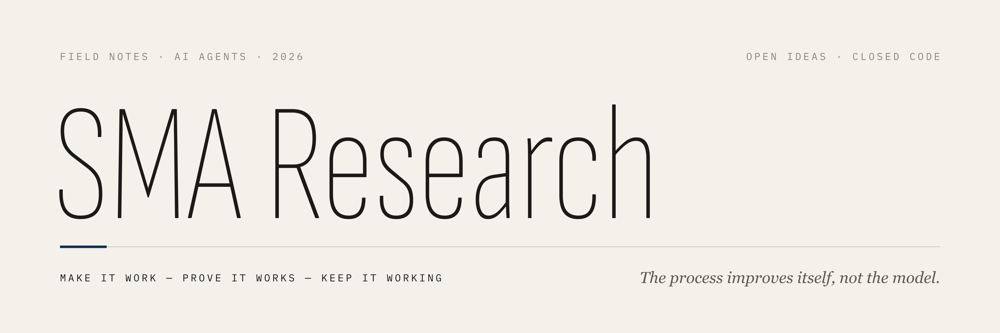

<picture>
  <source media="(prefers-color-scheme: dark)" srcset="assets/banner-dark.png">
  
</picture>

<b>EN</b> &nbsp;·&nbsp; <a href="README.ru.md">RU</a>

Field notes from building **SMA (Self-Mending Automation)**, a personal orchestrator for AI agents. The code is closed. The ideas, the numbers and the failures are here: not a recipe of our code, but a map of the road.

&nbsp;

###### THE THESIS

We don't try to make the model improve itself. We make the **process around the model** improve itself (the road, its gates, its memory, its judgment of what may be decided), and we prove every step of it.

&nbsp;

###### ISSUES

`2026.11.20` &nbsp; **[The model is the unreliable part](2026-11-20-the-model-is-the-unreliable-part/README.md)** 
Nine deterministic layers around a model that never will be: why it works on novel tasks, and what scale it opens

`2026.11.16` &nbsp; **[Every hole in our agent's guards was the same bug](2026-11-16-guards-read-what-runs/README.md)** 
The guard read one command and the shell ran another: six weeks of bypasses, and the rule that ended them

`2026.11.05` &nbsp; **[How far can an agent's memory search go?](2026-11-05-agent-memory-recall/README.md)** 
Vectors, a reranker and the road to 85–90 %: what worked, what did not, what is not proven

`2026.10.28` &nbsp; **[What goes into an agent's always-loaded memory](2026-10-28-what-goes-into-the-memory-core/README.md)** 
Five formulas lost to the hand-kept order; both exams lied first

`2026.10.19` &nbsp; **[Recursive improvement of the process, not of the model](2026-10-19-recursive-process-improvement/README.md)** 
The road that improves itself, and the blocks that make it safe

`earlier` &nbsp; **[Work graphs: how to make AI agents autonomous without losing control](https://github.com/matveymaslov/agent-work-graphs)** 
Six weeks of building work graphs, with the pain and the numbers

&nbsp;

###### HOW AN ISSUE IS BUILT

One or two pages in four parts: **built**, what we built and proved live; **broke**, what broke and the class it belongs to; **numbers**, runs, holes found and the price of proof; **a direction**, one thing worth thinking about, with questions for you. We guide; we don't hand over mechanisms.

###### THE TOOLS WE BUILD ON

When Claude Code itself surprises us, we write it down with a reproduction and the workaround we use: [claude-code-findings](claude-code-findings/README.md).

&nbsp;

---

Written by Matvey &nbsp;·&nbsp; Text [CC BY 4.0](LICENSE) &nbsp;·&nbsp; Ideas only, no code
